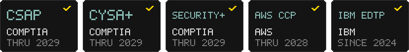

<div align="center">

<a href="https://bransonbailey.github.io"></a>

<br/><br/>



</div>

I'm a cybersecurity senior at **Anderson University (SC)**, an **IT Security Intern at Nucleus Security**, and an independent penetration tester. I build home labs, write the tooling to automate them, compete in the [National Cyber League](https://bransonbailey.github.io/ncl/index.html), and run my own self-hosted AI assistant, **A.E.G.I.S.**

```text
$ whoami
branson // cybersecurity student + penetration tester

$ cat now.txt
> IT Security Intern @ Nucleus Security
> Independent pentester for digital startups
> B.S. Cybersecurity @ Anderson University, Dec 2026
> Cybersecurity Club president, 2025-2026
> Building A.E.G.I.S., my self-hosted AI assistant
```

<div align="center">

<br/>



</div>

| When | Role | Highlights |
|:--|:--|:--|
| **May 2026 – now** | **IT Security Intern**<br/>Nucleus Security · Remote | Internship on the security team |
| **Apr 2026 – now** | **Penetration Tester**<br/>Self-employed · Remote | External pentests for digital startups: written reports with prioritized findings and risk ratings, plus follow-up retesting to confirm fixes |
| **Dec 2024 – May 2026** | **Cybersecurity Analyst**<br/>Anderson University | Campus-wide network monitoring, incident investigation and DF/IR, custom dashboards for malicious activity, compliance audits, and Elasticsearch ingest pipelines for firewall logs |
| **May 2024 – Dec 2024** | **Help Desk Support Specialist**<br/>Anderson University | Ticketing, Active Directory accounts, workstation setup |
| **Oct 2023 – Apr 2026** | **Player**<br/>National Cyber League | Individual and team CTFs; led multiple top-ranking teams |

🎓 **B.S. Cybersecurity**, Anderson University (SC), Dec 2026 · GPA 3.88 · Cybersecurity Club President (2025–2026)

<div align="center">

<br/>



<br/><br/>



<br/><br/>



<br/><br/>



<br/>



<br/>


</div>
